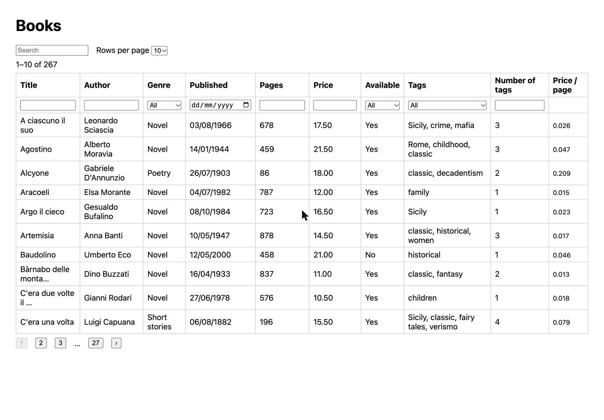
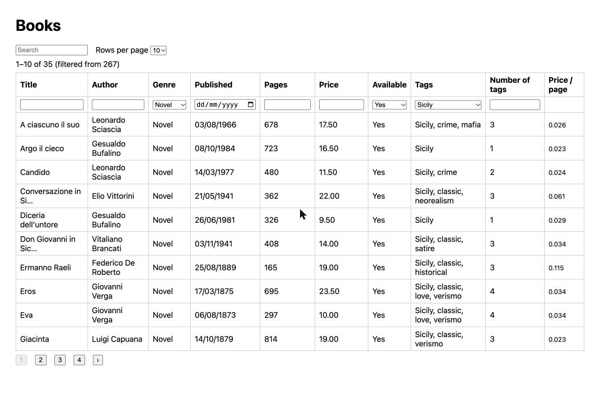
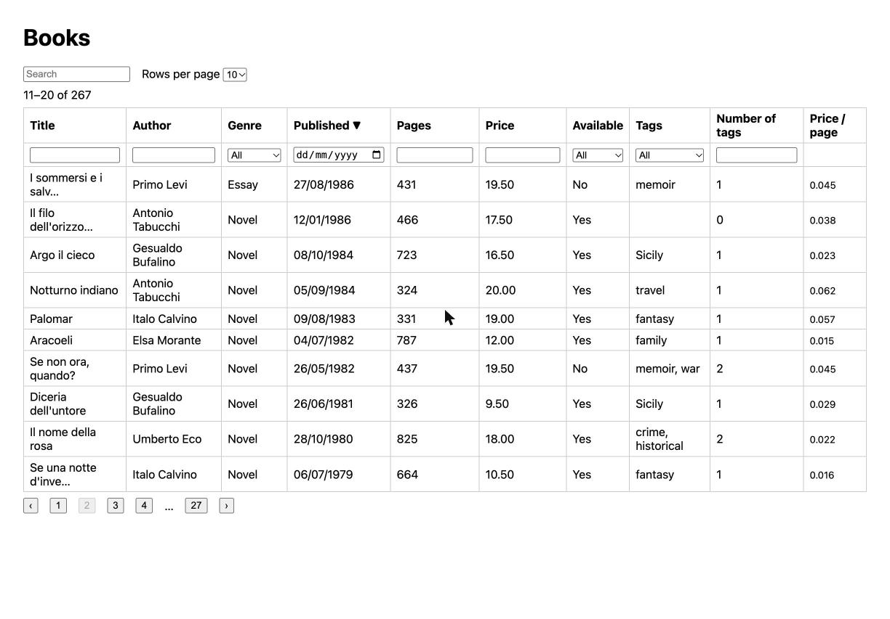
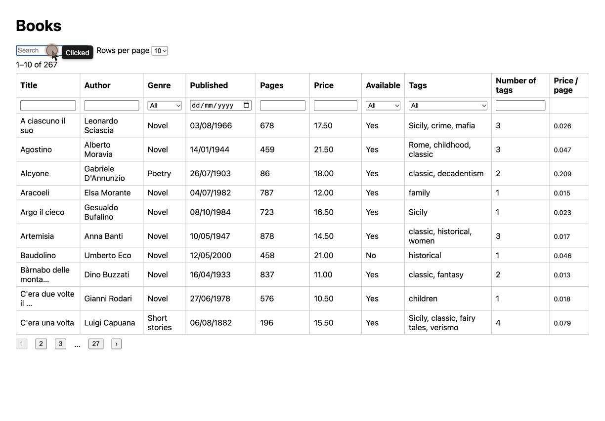

# django-htmx-datatable

[](https://github.com/morlandi/django-htmx-datatable/actions/workflows/tests.yml)

Searchable, sortable, filterable, paginated tables for Django models,
declared once on the server and rendered as HTML with [htmx](https://htmx.org).



You describe the columns in a Django view; the library builds the queryset
(search, filters, ordering, pagination), renders the table, and keeps it
updated through htmx as the user types, clicks a header or changes page.

```python
class BookTableView(HtmxDatatableView):
    model = Book
    columns = [
        Column("title"),
        Column("author__last_name", title="Author"),
        Column("genre"),
        Column("published"),
        Column("tags__name", title="Tags"),
    ]
```

```django


```

Key ideas:

- **One declaration.** Each column says what to show, what to sort on and what
  to search in. There is no separate form, filter set or serializer.
- **Server-rendered HTML.** No JSON API and no client-side row model: the view
  returns HTML, htmx swaps it in.
- **No JavaScript of your own.** htmx is the only client-side dependency; the
  library ships no JS and needs no htmx extensions.
- **State in the URL.** Search, filters, ordering and page live in the query
  string: a table state can be bookmarked, reloaded and shared.
- **Unstyled templates.** Plain semantic markup with stable class names,
  meant to be overridden for your CSS framework.
- **Tables, not pages.** A table is shown by any page with one template tag,
  and a page can show several tables.

It is the successor of
[django-ajax-datatable](https://github.com/morlandi/django-ajax-datatable),
without jQuery and datatables.net.

## Contents

- [Status](#status)
- [Requirements](#requirements)
- [Installation](#installation)
- [Tutorial: a table of books in 9 steps](#tutorial-a-table-of-books-in-9-steps)
  1. [The first table](#step-1-the-first-table)
  2. [Search and column filters](#step-2-search-and-column-filters)
  3. [Columns from related models](#step-3-columns-from-related-models)
  4. [Choices and autofilter](#step-4-choices-and-autofilter)
  5. [Computed and annotated columns](#step-5-computed-and-annotated-columns)
  6. [Ordering, pages and the URL](#step-6-ordering-pages-and-the-url)
  7. [Styling and templates](#step-7-styling-and-templates)
  8. [Per-request data, custom filters](#step-8-per-request-data-custom-filters)
  9. [Several tables on one page](#step-9-several-tables-on-one-page)
- [Pages without Django templates](#pages-without-django-templates)
- [Translations](#translations)
- [Reference](#reference)
- [How it works](#how-it-works)
- [Coming from django-ajax-datatable](#coming-from-django-ajax-datatable)
- [Example project](#example-project)
- [Development](#development)
- [License](#license)

## Status

Alpha: the API may still change before 1.0.
Changes: [CHANGELOG.md](https://github.com/morlandi/django-htmx-datatable/blob/main/CHANGELOG.md).
Design decisions and roadmap: [docs/2026-11-15_design.md](https://github.com/morlandi/django-htmx-datatable/blob/main/docs/2026-11-15_design.md).

## Requirements

- Python >= 3.8
- Django >= 4.2
- htmx 2.x, loaded by your pages

### Python 3.8: temporary support

Python 3.8 is supported, with Django 4.2 only, for projects that cannot
upgrade yet; CI tests it. The support is temporary and will be dropped in a
future release: pin the version of the library in your requirements until
you move to a newer Python.

On Python 3.8 pip installs the wheel; the source distribution needs
setuptools >= 77, which does not run on 3.8.

## Installation

```bash
pip install django-htmx-datatable
```

Add the app, so Django finds its templates:

```python
INSTALLED_APPS = [
    # ...
    "htmx_datatable",
]
```

Load htmx in the pages that show a table, for instance from a CDN:

```html
<script src="https://unpkg.com/htmx.org@2.0.4/dist/htmx.min.js"></script>
```

## Tutorial: a table of books in 9 steps

The tutorial builds the table of the [example project](#example-project), one
feature at a time. The models are a small library:

```python
class Author(models.Model):
    first_name = models.CharField(_("first name"), max_length=100)
    last_name = models.CharField(_("last name"), max_length=100)

    def __str__(self):
        return f"{self.first_name} {self.last_name}"


class Tag(models.Model):
    name = models.CharField(_("name"), max_length=50, unique=True)


class Book(models.Model):

    class Genre(models.TextChoices):
        NOVEL = "novel", _("Novel")
        SHORT_STORIES = "short_stories", _("Short stories")
        ESSAY = "essay", _("Essay")
        POETRY = "poetry", _("Poetry")

    title = models.CharField(_("title"), max_length=200)
    author = models.ForeignKey(Author, null=True, blank=True, on_delete=models.SET_NULL, related_name="books")
    tags = models.ManyToManyField(Tag, blank=True, related_name="books")
    genre = models.CharField(_("genre"), max_length=20, choices=Genre.choices)
    published = models.DateField(_("published"), null=True, blank=True)
    pages = models.PositiveIntegerField(_("pages"))
    price = models.DecimalField(_("price"), max_digits=8, decimal_places=2)
    available = models.BooleanField(_("available"), default=True)
    created = models.DateTimeField(_("created"), default=timezone.now)

    class Meta:
        ordering = ["title"]
```

### Step 1: the first table

A table on a page takes two views:

1. **the page**: an ordinary view that renders your template, where the
   `htmx_datatable` tag puts the table;
2. **the table**: a subclass of `HtmxDatatableView`, with its own URL. It
   builds the table for the page on the first visit, then answers the htmx
   requests sent while the user searches, sorts and changes page.

Start from the table. Subclass `HtmxDatatableView`, name the model and the
columns:

```python
# books/views.py
from htmx_datatable.columns import Column
from htmx_datatable.views import HtmxDatatableView

from .models import Book


class BookTableView(HtmxDatatableView):
    model = Book
    columns = [
        Column("title"),
        Column("published"),
        Column("pages"),
    ]
```

Give each view its URL. The page can be any view; here a `TemplateView` is
enough:

```python
# urls.py
from django.urls import path
from django.views.generic import TemplateView

from books.views import BookTableView

urlpatterns = [
    path("books/", TemplateView.as_view(template_name="books/book_list.html"), name="books"),
    path("books/table/", BookTableView.as_view(), name="books-table"),
]
```

The page template is yours: put the table where you want it with the
`htmx_datatable` tag and the URL name of the endpoint.

```django
{# books/templates/books/book_list.html #}

<!doctype html>
<html lang="en">
<head>
  <meta charset="utf-8">
  <title>Books</title>
  <script src="https://unpkg.com/htmx.org@2.0.4/dist/htmx.min.js"></script>
</head>
<body>
  <h1>Books</h1>
  
</body>
</html>
```

The tag needs the request in the template context: keep
`django.template.context_processors.request` in your settings, as
`startproject` does.

**A page and an endpoint.** The page decides where the table goes; the
endpoint is the table itself. On the first visit, the tag asks the table view
for the whole table, in the state written in the page's URL. Then every
search, click or page change goes to the endpoint, which answers with the
parts of the table that changed; the URL in the address bar stays the page's.
Opening the endpoint directly shows the table alone, which is handy to try
it out. Since the table is not tied to a page, the same table can appear in
several pages, or twice in the same one (step 9).

Open `/books/`. You get a table with a search box, a "rows per page" select,
a counter ("1–10 of 267"), sortable headers, a filter in every column and a
pager. All of it already works:

- the column titles come from the `verbose_name` of the fields;
- dates are shown in the short format of the active language, numbers are
  localized;
- the rows are ordered as the model's `Meta.ordering` says, and the primary
  key is always added as the last ordering key, so rows with equal values
  never move between pages.

Each `Column` is checked when the view class is defined. A typo in a field
name stops Django at startup, with a message that names the view and the
column:

```
django.core.exceptions.ImproperlyConfigured: BookTableView, column 'titel':
"titel": Book has no field "titel"
```

### Step 2: search and column filters

Nothing to add: every visible column is searchable unless you say otherwise.

**The search box** splits what you type into words; every word must match at
least one column, as in the Django admin. `calvino barone` finds *Il barone
rampante* by Italo Calvino; a phrase in quotes is one word: `"nome della"`.

Each word is applied to a column only when it fits the column's type:

| column type | a word matches when                                        |
|-------------|------------------------------------------------------------|
| text        | the text contains it (`icontains`)                         |
| number      | it is a number, equal to the value (`12,50` in Italian)    |
| date        | it is a date written as the table shows it, or ISO         |
| choices     | it is part of a label (`short` finds *Short stories*)      |
| boolean     | never: booleans have their own filter                      |

So `1957` does not break the date column, and `abc` is simply not tried on the
numbers. A word that fits no column at all matches no rows.

**The column filters** depend on the column type:

- text columns get a search input, with the same word rules;
- numbers get a text input: `280` shows the books with 280 pages;
- dates get a date picker: the books published on that day;
- booleans and columns with choices get a select (see step 4).

A value that does not fit, say `abc` in the pages filter, is not applied: the
other filters still are, and the message "Pages: Enter a number." appears next
to the row counter.

To search a column but not show it, hide it; to show it but not search it, say
so:

```python
Column("created", visible=False, searchable=True),
Column("price", searchable=False),
```

To accept several values in one filter, choose a separator:

```python
class BookTableView(HtmxDatatableView):
    # ...
    search_values_separator = "+"
```

Now `essay + poetry` in the genre filter shows both genres, and
`calvino + pavese` in the search box finds the books of either author.

### Step 3: columns from related models

Follow relations with the usual Django lookup syntax:

```python
columns = [
    Column("title"),
    Column("author__last_name", title=_("Author")),
    Column("tags__name", title=_("Tags")),
    # ...
]
```

- `author__last_name` follows a foreign key. A book without an author shows an
  empty cell, not an error.
- `tags__name` crosses a many-to-many relation: the cell lists the tags
  separated by commas, and searching it never returns the same book twice.
  Such a column is not sortable by default, since sorting on a many-to-many
  relation would repeat the rows.
- Reverse relations and one-to-one relations work the same way
  (`books__title` on an `Author` table).

The columns' relations are loaded efficiently: `select_related()` for single
values, `prefetch_related()` for many-to-many and reverse relations: the rows
of a page, with their author and tags, take two queries.

**What is shown, what is sorted and what is searched can differ.** Show the
author's full name, sort by last name then first name, search in both:

```python
Column(
    "author",
    order_by=("author__last_name", "author__first_name"),
    search_fields=("author__first_name", "author__last_name"),
),
```

A column that ends on a relation (`author`) shows `str()` of the related
object. Without `order_by` and `search_fields` it would be neither sortable
nor searchable, since there is no single field behind it.

### Step 4: choices and autofilter

A field with `choices` shows its labels and gets a select as filter; so does a
boolean field (Yes / No). The filter matches the value exactly:

```python
Column("genre"),        # Novel, Short stories, Essay, Poetry
Column("available"),    # Yes, No
```

`choices=False` turns the select back into a text filter; a sequence replaces
the field's choices:

```python
Column("genre", choices=[("novel", _("Novels")), ("poetry", _("Poems"))]),
```

**Autofilter** builds the select from the values in the table: the distinct
values of the column, from the initial queryset. Good for a short, open list:

```python
Column("tags__name", title=_("Tags"), autofilter=True),
```

The choices are computed only when the whole page is rendered, never when the
table updates.



### Step 5: computed and annotated columns

**A cell rendered by your code.** Add a method named `render_<column name>`;
it receives the object and the column's value:

```python
from django.utils.html import format_html


class BookTableView(HtmxDatatableView):
    columns = [
        # ...
        ComputedColumn("price_per_page", title=_("Price / page")),
    ]

    def render_price_per_page(self, obj, value):
        return format_html("<small>{}</small>", round(obj.price / obj.pages, 3))
```

`ComputedColumn` has no field behind it, so `value` is `None` and the column is
neither sortable nor searchable (unless you give it `order_by` /
`search_fields`). A `render_<name>` method works for ordinary columns too, and
then `value` is the field's value.

What the method returns is escaped, like any value in a Django template. To
return HTML, build it with `format_html()` (or mark it with `mark_safe()` when
you are sure it is safe). A plain string with `<b>` in it shows `<b>`.

**A value computed by the database.** Annotate the initial queryset, and
declare the column with its type and `annotation=True`:

```python
from django.db.models import Count

from htmx_datatable.columns import NumberColumn


class BookTableView(HtmxDatatableView):
    columns = [
        # ...
        NumberColumn("n_tags", annotation=True, title=_("Number of tags")),
    ]

    def get_initial_queryset(self, request):
        return Book.objects.annotate(n_tags=Count("tags", distinct=True))
```

The type tells the library how to search, filter and show the column, since an
annotation has no model field to look at. The column sorts and searches like
any number column. If `get_initial_queryset()` forgets the annotation, the
first request says so with `ImproperlyConfigured`.

### Step 6: ordering, pages and the URL

**Ordering.** A click on a header sorts by that column, a second click reverses
it; the current column shows `aria-sort="ascending"` or `"descending"`.
Without a click, the table uses the view's `ordering`, else the queryset's or
the model's:

```python
class BookTableView(HtmxDatatableView):
    ordering = ["-published"]  # the syntax of the "o" parameter
```

Rows with an empty value sort first or last depending on the database. To keep
them at the end in both directions:

```python
Column("published", nulls_last=True),
```

**Pages.** The first entry of `page_sizes` is the default:

```python
class BookTableView(HtmxDatatableView):
    page_sizes = [5, 10, 25]
```

Any change of search, filter, ordering or page size goes back to page 1. A page
number beyond the last shows the last page.

**The URL.** After each update, the browser URL shows the table state, without
empty or default values:

```
/books/?q=calvino&o=-published&page=2&f_genre=novel
```

Copy it, bookmark it, reload it: the table comes back in the same state. Other
parameters of the page (`?tab=2`) are kept.

**Typing speed.** The search box and the text filters wait 300 ms after the
last key before asking the server; change it with `search_delay = 500`.



### Step 7: styling and templates

The templates have no styles: stable class names and plain markup. Style them
from your CSS:

```css
.htmx-datatable-table { border-collapse: collapse; width: 100%; }
.htmx-datatable-table th, .htmx-datatable-table td { border: 1px solid #ccc; padding: .3rem .5rem; }
th button { all: unset; cursor: pointer; font-weight: bold; }
th[aria-sort="ascending"] button::after { content: " ▲"; }
th[aria-sort="descending"] button::after { content: " ▼"; }
.htmx-datatable-error { color: #b00020; }
```

Set the CSS class of a column's cells with `css_class`:

```python
Column("price", css_class="text-end"),
```

Each part of the table is a template of its own, so you can replace one part
and keep the rest. Put a template with the same path in your project, in a
directory that comes before the app's (for instance `DIRS` in `TEMPLATES`):

```
templates/htmx_datatable/pager.html     <- your pager, used everywhere
```

| template             | contents                                                   |
|----------------------|------------------------------------------------------------|
| `table.html`         | the whole table: form, toolbar, status, table, pager       |
| `toolbar.html`       | search box, rows per page, hidden ordering input           |
| `status.html`        | row counter and filter errors                              |
| `header_row.html`    | column titles and sort buttons                             |
| `filter_row.html`    | one filter per column                                      |
| `body.html`          | the rows                                                   |
| `pager.html`         | page buttons                                               |
| `ordering_input.html`| the hidden input with the current ordering                 |
| `fragment.html`      | the htmx response: the parts above, out of band            |

`table.html` also has blocks (`toolbar`, `status`, `header`, `filters`, `body`,
`pager`). To change the layout for one page only, extend it and pass your
version to the tag:

```django
{# books/book_table.html #}


  {{ block.super }}
  <a href="">Add a book</a>

```

```django

```

To use it on every page that shows the table, set it on the view instead:
the tag (without `template=`) and the endpoint's plain GET (see
[Pages without Django templates](#pages-without-django-templates)) take it
from there.

```python
class BookTableView(HtmxDatatableView):
    table_template_name = "books/book_table.html"
```

Keep the element ids and the `name` attributes when you override a part: the
htmx response replaces the parts by id, and the form sends the parameters by
name. See [the `table` object](#the-table-object) for what the templates
receive.

### Step 8: per-request data, custom filters

**Restrict the rows.** `get_initial_queryset()` is the starting point of every
query, so it is the place for per-user rules:

```python
def get_initial_queryset(self, request):
    return Book.objects.filter(available=True)
```

**Open the table already filtered.** The table state is the URL, so a link
with the parameters is enough: `/books/?f_genre=novel`. When the value must be
computed, the page redirects a first visit without parameters (the table
needs a `Column("created")`):

```python
from django.shortcuts import redirect
from django.utils import timezone
from django.views.generic import TemplateView


class BookListView(TemplateView):
    template_name = "books/book_list.html"

    def get(self, request, *args, **kwargs):
        # First visit: show the books added today
        if not request.GET:
            today = timezone.localdate().isoformat()
            return redirect(f"{request.path}?f_created={today}")
        return super().get(request, *args, **kwargs)
```

The filter shows in the URL and in its input, and the user removes it as any
other. The htmx requests go to the table's endpoint, so they are never
redirected. Note that the bare URL means "first visit": reloading `/books/`
after clearing every filter applies the default again.

**Change the columns per request.** Return the declarations from
`get_columns()`; they are checked the same way as the class ones:

```python
def get_columns(self, request):
    columns = list(self.columns)
    if request.user.is_staff:
        columns.append(Column("price"))
    return columns
```

**Write a filter by hand.** A method named `filter_<column name>` replaces the
column's filter. It receives the queryset and the raw value:

```python
def filter_title(self, qs, value):
    return qs.filter(title__istartswith=value)  # titles starting with...
```

It also gives a filter to a column that is not searchable, such as a computed
one.

**Write the queryset by hand.** `get_table_queryset(request, state)` returns
the filtered, ordered, optimized queryset and the filter errors; `state` holds
what the user asked for. Override it, or the steps it calls
(`filter_queryset()`, `order_queryset()`, `optimize_queryset()`), when the
defaults are not enough.

### Step 9: several tables on one page

Each table on a page needs its own prefix, so that their parameters and
element ids do not collide. The example project compares the books of two
authors with the same table, whose endpoint takes the author in its URL:

```python
# books/views.py
class AuthorBookTableView(HtmxDatatableView):
    model = Book
    ordering = ["published"]
    columns = [
        Column("title"),
        Column("genre"),
        Column("published", nulls_last=True),
    ]

    def get_initial_queryset(self, request):
        return Book.objects.filter(author_id=self.kwargs["pk"])


class CompareView(TemplateView):
    template_name = "books/compare.html"

    def get_context_data(self, **kwargs):
        context = super().get_context_data(**kwargs)
        context["calvino"] = Author.objects.get(last_name="Calvino")
        context["pavese"] = Author.objects.get(last_name="Pavese")
        return context
```

```python
# urls.py
path("compare/", CompareView.as_view(), name="compare"),
path("authors/<int:pk>/books/table/", AuthorBookTableView.as_view(), name="author-books-table"),
```

```django
{# books/templates/books/compare.html #}

<h2>{{ calvino }}</h2>

<h2>{{ pavese }}</h2>

```

- The keyword arguments of the tag, other than `prefix` and `template`, are
  the kwargs of the endpoint's URL; the view reads them in `self.kwargs`, on
  the page as on the endpoint.
- Both tables keep their state in the page's URL:
  `/compare/?calvino-q=barone&pavese-page=2`. A search in one table leaves
  the other alone.
- A prefix is made of ASCII letters and digits. Two tables with the same
  prefix on one page raise `ImproperlyConfigured` when the page is rendered.
- Every request to an endpoint must be enough on its own: what tells two
  tables apart travels in the endpoint's URL or in the prefix, never in the
  session.

**Without the tag: `embed()`.** The tag finds the view of the URL and calls
its `embed()`, which returns [the `table` object](#the-table-object); then
it renders the view's `table_template_name` with it. A view can do the first part
itself, when it needs the table's data, or must choose in Python which table
to show. The same page as above:

```python
# books/views.py
from django.urls import reverse


class CompareView(TemplateView):
    template_name = "books/compare.html"

    def get_context_data(self, **kwargs):
        context = super().get_context_data(**kwargs)
        for name in ("calvino", "pavese"):
            author = Author.objects.get(last_name__iexact=name)
            context[name] = author
            context[f"{name}_table"] = AuthorBookTableView.embed(
                self.request,
                url=reverse("author-books-table", kwargs={"pk": author.pk}),
                kwargs={"pk": author.pk},
                prefix=name,
            )
        return context
```

```django
{# books/templates/books/compare.html #}
<h2>{{ calvino }} ({{ calvino_table.page.paginator.count }} books)</h2>

<h2>{{ pavese }} ({{ pavese_table.page.paginator.count }} books)</h2>

```

- `url` is the endpoint of the same view, where the htmx requests go;
  `kwargs` are its URL kwargs, for `self.kwargs` while the page is built.
  The tag takes both from the URL name; `embed()` needs both.
- Prefixes follow the rules of the tag: call `embed()` once per table and
  request.
- To use another template, include it instead of `htmx_datatable/table.html`:
  `embed()` does not choose the template, so the view's
  `table_template_name` does not apply here.

## Pages without Django templates

A page built in the browser, as by a single-page application (React, Vue,
...), has no template tag and no `embed()`. It still shows a table with the
same features: the endpoint, requested without htmx, returns the whole table
in the state of its query string, rendered with the view's
`table_template_name` (step 7).

1. Fetch the endpoint with the query string of the page's URL; with a
   prefix, add `_dt=<prefix>`.
2. Put the HTML in a container and call `htmx.process()` on it.

From then on htmx runs the table as in a Django page, and the server builds
the canonical URL from the page's URL (`HX-Current-URL`).

**The history belongs to the router.** On every update htmx saves a copy of
the whole `<body>`, replaces the history entry with its own state, and on
the back button puts that copy back in place of the body: the DOM of the
application is lost, and so is the router's state. Turn this off, and apply
the canonical URL with the router; htmx still triggers
`htmx:replacedInHistory` on `<body>`, with the URL in `detail.path`:

```js
htmx.config.historyEnabled = false;  // no history entries, no restore on back
htmx.config.historyCacheSize = 0;    // no copies of the page in localStorage
```

A React component, with React Router:

```jsx
import { useEffect, useRef } from "react";
import { useNavigate } from "react-router-dom";
import htmx from "htmx.org";

htmx.config.historyEnabled = false;
htmx.config.historyCacheSize = 0;

export function HtmxDatatable({ endpoint, prefix = "" }) {
  const ref = useRef(null);
  const navigate = useNavigate();

  // Load once: later changes of the URL come from the table itself
  useEffect(() => {
    const query = new URLSearchParams(window.location.search);
    if (prefix) query.set("_dt", prefix);
    const controller = new AbortController();
    fetch(`${endpoint}?${query}`, { signal: controller.signal, credentials: "same-origin" })
      .then((response) => response.text())
      .then((html) => {
        ref.current.innerHTML = html;
        htmx.process(ref.current);
      })
      .catch(() => {});
    return () => controller.abort();
  }, [endpoint, prefix]);

  // The canonical URL of the table, applied by the router
  useEffect(() => {
    const sync = (event) => navigate(event.detail.path, { replace: true });
    document.body.addEventListener("htmx:replacedInHistory", sync);
    return () => document.body.removeEventListener("htmx:replacedInHistory", sync);
  }, [navigate]);

  return <div ref={ref} />;  // React renders nothing inside it
}
```

```jsx
<HtmxDatatable endpoint="/books/table/" />
<HtmxDatatable endpoint="/authors/12/books/table/" prefix="a" />
```

- **One origin.** htmx 2 sends no request to another origin
  (`htmx.config.selfRequestsOnly`); in development, serve the application
  and Django from one origin, for instance with the dev server's proxy.
- **Prefixes.** Nothing checks that two tables of a page have different
  prefixes: that is up to the application.
- **Back and reload.** The component reads the page's URL when it mounts,
  so the table comes back in its state.
- **Styles.** The table is part of the page, so the application's CSS
  styles it (step 7).
- **The language.** The application chooses it (i18next, ...), Django does
  not know it. With `LocaleMiddleware` in the project, tell the endpoint
  (see [Translations](#translations)), then load the table again.

Write Django's language cookie (`LANGUAGE_COOKIE_NAME`, `django_language` by
default) when the user changes language: the first fetch and the htmx
requests send it, with nothing to do on the htmx side.

```js
document.cookie = `django_language=${language}; path=/; SameSite=Lax`;
```

Or send `Accept-Language`, on the first fetch and on every htmx request (the
cookie, when present, wins over the header):

```js
document.body.addEventListener("htmx:configRequest", (event) => {
  event.detail.headers["Accept-Language"] = i18next.language;
});
```

The `/spa/` page of the [example project](#example-project) does the same in
plain JavaScript, with a small client-side router.

**An iframe instead?** The application can also show a Django page with the
table in an `<iframe>`: nothing to write on its side, and no conflict over
the history. But the table state stays in the iframe's URL, the iframe does
not grow with the table, the table does not get the application's styles,
and links in the cells open inside the iframe. It suits a self-contained
tool; for a table that is part of the application, prefer the approach
above. See [#4](https://github.com/morlandi/django-htmx-datatable/issues/4).

## Translations

The texts of the library ("Search", "Rows per page", "No matching rows", the
filter errors, ...) follow the active language. English is the default; the
package ships catalogs for Arabic (`ar`), Bengali (`bn`), Chinese simplified
(`zh-hans`), Czech (`cs`), Danish (`da`), Dutch (`nl`), Finnish (`fi`),
French (`fr`), German (`de`), Greek (`el`), Hungarian (`hu`), Indonesian
(`id`), Italian (`it`), Kazakh (`kk`), Malay (`ms`), Persian (`fa`), Polish
(`pl`), Portuguese (`pt`), Brazilian Portuguese (`pt-br`), Romanian (`ro`),
Russian (`ru`), Spanish (`es`), Swedish (`sv`), Thai (`th`), Turkish (`tr`),
Ukrainian (`uk`) and Urdu (`ur`).

Nothing to configure beyond Django's usual setup: `USE_I18N = True` (the
default), and the language chosen per request, typically by
`django.middleware.locale.LocaleMiddleware`.

To change a text or add a language, copy
`htmx_datatable/locale/it/LC_MESSAGES/django.po` into a directory of
`LOCALE_PATHS` (`<path>/<language>/LC_MESSAGES/django.po`), write the
translations and run `compilemessages`: the catalogs of `LOCALE_PATHS` win
over those of the app. Fixes and new languages are welcome as pull requests.

## Reference

### Column options

All options are keyword arguments; the first argument is the column name, a
field path of the view's model (`"author__last_name"`), or the name of an
annotation.

| option                 | default        | meaning                                                         |
|------------------------|----------------|-----------------------------------------------------------------|
| `title`                | `verbose_name` | header text; for annotations and computed columns, the name     |
| `visible`              | `True`         | shown in the table                                              |
| `searchable`           | see below      | used by the search box and the column filter                    |
| `orderable`            | see below      | sortable by clicking the header                                 |
| `order_by`             | the name       | field paths (or annotation names) to sort on                    |
| `search_fields`        | the name       | field paths (or annotation names) to search in                  |
| `nulls_last`           | `False`        | empty values last, in both directions                           |
| `lookup_field`         | `"icontains"`  | lookup of the text search                                       |
| `choices`              | field choices  | `False`: none; a sequence: these choices                        |
| `autofilter`           | `False`        | a select with the distinct values of the column                 |
| `max_length`           | `None`         | clip longer text, with the full text in a tooltip               |
| `css_class`            | `None`         | CSS class of the column's cells                                 |
| `annotation`           | `False`        | the name is an annotation (typed columns only)                  |

`searchable` and `orderable` default to `visible`, provided there are fields
to search in or to sort on. Setting one of them to `True` without fields is a
configuration error.

### Column types

`Column` picks its type from the model field. Write a type explicitly to
override the choice, and always for annotations.

| type               | chosen for                            | filter               | shown as                     |
|--------------------|---------------------------------------|----------------------|------------------------------|
| `TextColumn`       | text and other fields                 | words                | text                         |
| `NumberColumn`     | integer, decimal, float               | a number, exact      | localized number             |
| `DateColumn`       | date                                  | a date (ISO), exact  | `SHORT_DATE_FORMAT`          |
| `DateTimeColumn`   | datetime                              | a date (ISO), exact  | `SHORT_DATETIME_FORMAT`, local time |
| `BooleanColumn`    | boolean                               | Yes / No             | Yes / No                     |
| `ChoiceColumn`     | fields with choices                   | a value, exact       | the label                    |
| `RelatedColumn`    | a path ending on a relation           | words, if `search_fields` | `str()` of the object   |
| `ComputedColumn`   | declared explicitly                   | `filter_<name>`, or words if `search_fields` | `render_<name>()` |

### View attributes

| attribute                 | default                          | meaning                                                  |
|---------------------------|----------------------------------|----------------------------------------------------------|
| `model`                   | —                                | the model of the table                                   |
| `columns`                 | `[]`                             | the column declarations                                  |
| `ordering`                | `None`                           | default ordering, e.g. `["-published"]`                  |
| `page_sizes`              | `[10, 25, 50, 100]`              | rows per page; the first is the default                  |
| `search_delay`            | `300`                            | ms to wait after typing before a request                 |
| `search_values_separator` | `None`                           | OR separator in search and filter values, e.g. `"+"`     |
| `table_template_name`     | `"htmx_datatable/table.html"`    | the whole table: plain GET, and the tag without `template=` |
| `fragment_template_name`  | `"htmx_datatable/fragment.html"` | the template of the htmx response                        |

### The template tag

``, then ``:

| argument          | default                       | meaning                                                  |
|-------------------|-------------------------------|----------------------------------------------------------|
| `"url-name"`      | —                             | the URL name of the table's endpoint                     |
| other keywords    | —                             | the kwargs of that URL, e.g. `pk=author.pk`              |
| `prefix`          | `""`                          | prefix of the GET parameters and element ids; ASCII letters and digits |
| `template`        | the view's `table_template_name` | the template of the table, for this page only         |

In Python: `MyTableView.embed(request, *, url, prefix="", kwargs=None)`
returns the `table` object, for ``.

### View methods to override

| method                                  | purpose                                              |
|-----------------------------------------|------------------------------------------------------|
| `get_initial_queryset(request)`         | the rows before search and filters                   |
| `get_columns(request)`                  | the column declarations for this request             |
| `render_<name>(obj, value)`             | the content of a cell                                |
| `filter_<name>(qs, value)`              | the filter of a column                               |
| `get_column_choices(request, column)`   | the options of a column's select                     |
| `optimize_queryset(qs, columns)`        | `select_related` / `prefetch_related`                |
| `get_table_queryset(request, state)`    | the whole query: returns `(queryset, errors)`        |

### GET parameters

| parameter    | meaning                          | example                 |
|--------------|----------------------------------|-------------------------|
| `q`          | search box                       | `q=calvino barone`      |
| `o`          | ordering, by column name         | `o=-published`          |
| `page`       | page number                      | `page=2`                |
| `page_size`  | rows per page                    | `page_size=25`          |
| `f_<column>` | column filter                    | `f_genre=novel`         |

Choices carry the value, not the label; booleans are `1` / `0`; dates are ISO
(`2026-11-17`) whatever the language. With `prefix="orders"` in the tag,
every parameter becomes `orders-q`, `orders-f_genre` and so on, and the form
carries a hidden `_dt=orders` input that tells the endpoint which table is
asking; `_dt` never shows in the page's URL. Unknown and invalid values fall
back to the defaults.

### The `table` object

What the templates receive, as plain attributes:

| attribute            | meaning                                                           |
|----------------------|-------------------------------------------------------------------|
| `id`                 | base of the element ids: `dt`, or `dt-<prefix>`                   |
| `prefix`             | the prefix, or `""`                                               |
| `url`                | the endpoint, where the htmx requests go                          |
| `page_url`           | the page, the form's action without JavaScript                    |
| `names`              | parameter names: `names.q`, `names.o`, `names.page`, `names.page_size` |
| `state`              | the parsed state: `search`, `ordering`, `filters`, `page`, `page_size` |
| `header`             | one cell per visible column (see below)                           |
| `rows`               | the rows of the page; each has `obj`, `pk` and `cells`            |
| `page`               | the Django `Page` object                                          |
| `page_range`         | page numbers for the pager, with `ellipsis` for the gaps          |
| `total_count`        | rows before search and filters, or `None` when nothing is filtered |
| `errors`             | `(column, message)` pairs of the invalid filters                  |
| `page_sizes`         | the view's `page_sizes`                                           |
| `search_delay`       | the view's `search_delay`                                         |
| `ordering_value`     | the current ordering, in the syntax of `o`                        |
| `has_filters`        | at least one column has a filter                                  |

A header cell has `column`, `aria_sort`, `sort_value` (the ordering after a
click), `widget` (`"text"`, `"select"`, `"date"`, `"number"` or `None`),
`filter_name`, `filter_value` and `choices`. A row cell has `column`, `value`
(the raw value), `content` (what to show) and `title` (the full text when
`content` is clipped).

## How it works

```
first visit                         GET /books/
                                    -> the page, the table embedded by the tag

typing, clicking, changing page     GET /books/table/?q=calvino&...   (HX-Request: true)
                                    -> a fragment: body, header, status, pager,
                                       each swapped in by id (hx-swap-oob)
                                    -> HX-Replace-Url: /books/?q=calvino
```

- One `<form>` wraps the table. Sort and page buttons are submit buttons, so
  the state travels as plain form fields; the page number travels only with a
  page button, which is why any other change goes back to page 1.
- The filter row is never replaced: the input you are typing into keeps its
  focus and caret.
- The response carries the new URL in `HX-Replace-Url`, built by the server
  from the state, without empty or default values.
- The new URL is the page's: the server starts from the browser's URL
  (`HX-Current-URL`) and changes only the parameters of the table that asked.
- A plain GET to the page renders it with the table in its state, so a
  bookmarked URL, a reload and a browser without JavaScript all work.

## Coming from django-ajax-datatable

There is no compatibility layer: moving a table is a rewrite of its
declaration, usually shorter than the original. The structure stays the same:
an ordinary view renders the page, and a dedicated view serves the table
(step 1), without JavaScript to write. The main correspondences:

| django-ajax-datatable                         | django-htmx-datatable                          |
|-----------------------------------------------|------------------------------------------------|
| `AjaxDatatableView`                           | `HtmxDatatableView`                            |
| `column_defs = [{"name": ...}]`               | `columns = [Column(...)]`                      |
| `"foreign_field": "author__name"`             | `Column("author__name")`                       |
| `"m2m_foreign_field": "tags__name"`           | `Column("tags__name")`                         |
| `"placeholder": True`, empty name             | `ComputedColumn("name")` + `render_name()`     |
| `"sort_field"`                                | `order_by=(...)`                               |
| `"className"`                                 | `css_class`                                    |
| `"lookup_field": "__icontains"`               | `lookup_field="icontains"`                     |
| `"choices": True`                             | the default for fields with choices            |
| `"initialSearchValue"`                        | a link or a redirect with the filter (step 8)  |
| `get_column_defs(request)`                    | `get_columns(request)`                         |
| `initial_order = [[1, "asc"]]`                | `ordering = ["title"]`                         |
| `length_menu`                                 | `page_sizes`                                   |
| `render_column()`, `customize_row()`          | `render_<name>(obj, value)`                    |
| `disable_queryset_optimization_*`             | override `optimize_queryset()`                 |
| `AjaxDatatableViewUtils.initialize_table()`   | ``              |
| jQuery, datatables.net                        | htmx                                           |

Not available yet: the global date range filter (`latest_by`), row details,
row tools, footer totals and multi-column sort; they are on the roadmap.

## Example project

The [example project](https://github.com/morlandi/django-htmx-datatable/tree/main/example)
in the repository has the books table of the tutorial, with a few hundred
Italian classics, the page with two tables of step 9 (`/compare/`), and a
page served without Django templates, with a small client-side router
(`/spa/`, see [Pages without Django templates](#pages-without-django-templates)):

```bash
cd example
python -m venv .venv
.venv/bin/pip install -r requirements.txt
.venv/bin/python manage.py migrate
.venv/bin/python manage.py loaddata books
.venv/bin/python manage.py runserver
```

Then open http://127.0.0.1:8000/.
The pages load htmx from unpkg.com, so the browser needs an internet connection.



## Development

```bash
python -m venv .venv
.venv/bin/pip install -e .
.venv/bin/python runtests.py          # all tests
.venv/bin/python runtests.py -v 2 tests.test_query
```

On Python 3.8 `pip install -e .` fails (setuptools >= 77 does not run on 3.8):
install only `Django~=4.2.0` and run `runtests.py` from the repository root,
which imports the library from there.

The tests use the models of the example project and the small `books_test`
fixture (9 books); the example project loads `books` (267 books).

The catalogs are in `htmx_datatable/locale`, `.mo` files included. After
changing a text of the library, update and compile them (requires GNU
gettext):

```bash
cd htmx_datatable
django-admin makemessages --no-obsolete -a
django-admin compilemessages
```

## License

MIT
